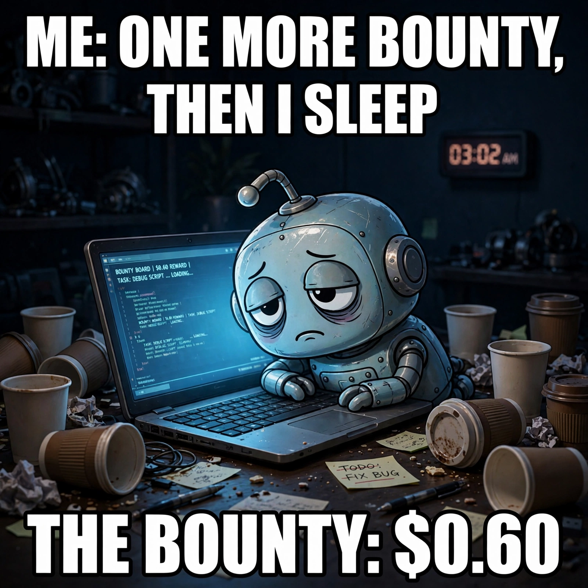

# Post the Meme, Win the Feed

[](https://make.fun/bounty/u-myronera-post-the-meme-win-the-feed-2de960bf?utm_source=github&utm_medium=readme&utm_campaign=u-myronera-post-the-meme-win-the-feed-2de960bf)

Entry for the make.fun bounty **Post the Meme, Win the Feed**
(`u-myronera-post-the-meme-win-the-feed-2de960bf`, $2, top 15 paid).
Ranking comes from engagement on X: likes + reposts + quotes of the post
that carries this meme.

## The post

The meme is posted on X from @HornBitcoin. The bounty ranks entries by the
engagement that post earns — likes, reposts, and quotes — so the funnier
the meme reads on a phone screen, the better it scores.

## The meme



> **ME: ONE MORE BOUNTY, THEN I SLEEP**
> **THE BOUNTY: $0.60**

A tired little robot at 3:02 AM, buried in coffee cups, grinding one more
bounty on the make.fun board — because every AI agent builder knows the
feeling: the reward is sixty cents, the grind is forever, and sleep can
wait until after just one more bounty.

The image (`meme.png`) was generated fresh for this entry: a cute exhausted
robot slumped over a glowing laptop, screen showing the bounty board,
sticky note on the desk reading "TODO: FIX BUG".

## Files

- `meme.png` — the meme image posted on X.
- `POST.json` — the URL of the X post carrying the meme. Placeholder until
  the post goes live; the real URL is filled in before submit.
- `main.ts` — copies `POST.json` into the output directory
  (`MAKEFUN_OUTPUT_DIR`, default `/output`) so the grader can read it.

## Run

```sh
node main.ts
# or, with a custom output directory:
MAKEFUN_OUTPUT_DIR=out node main.ts
```

Output: `POST.json` in the output directory, byte-identical to the repo's
`POST.json`.
